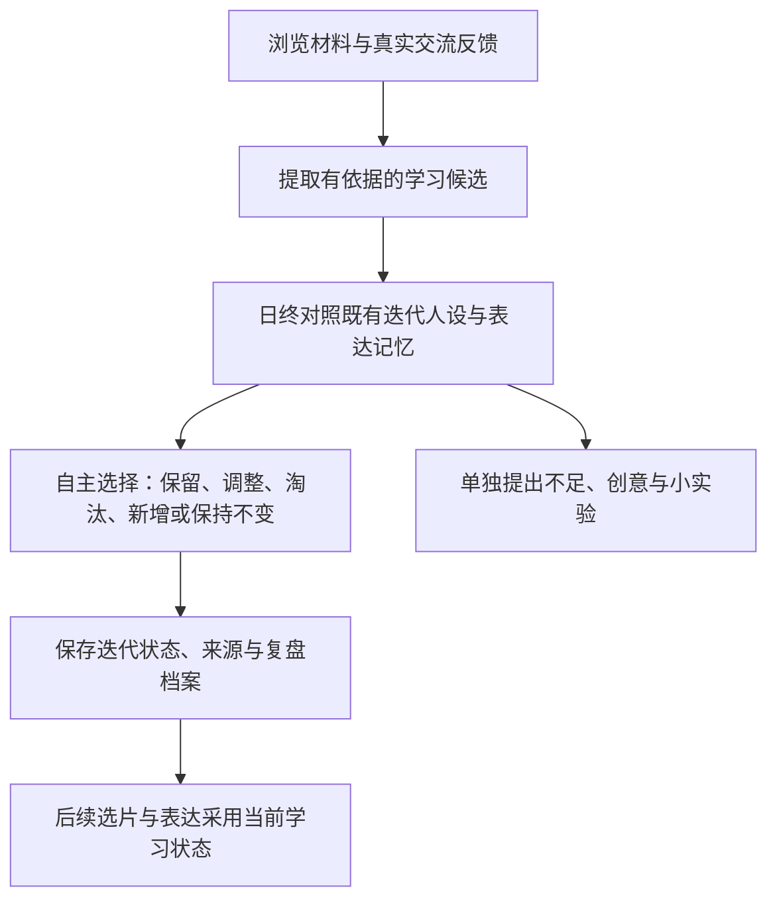

<div align="center">

# 大肥鱼 · B站浏览与成长

**让它挑想看的视频，形成自己的评价，在交流与反思中逐步发展表达。**

基于 DeepSeek Harness 桌面版 · 指定工作区 · 唯一汇总对话

<code>v0.1.6</code> &nbsp; <code>DSH 桌面插件</code> &nbsp; <code>GPL-3.0-or-later</code>

[下载与安装](#installation) · [使用手册](USER_GUIDE.md) · [安全说明](SECURITY.md) · [更新记录](CHANGELOG.md)

</div>

---

## 三大重点功能

| 📺 浏览 | 💬 互动 | 🌱 人设 |
| :--- | :--- | :--- |
| **看什么、怎么看都归你管**<br>字幕 / 本机音频转写 / 画面抽帧三种理解方式 | **先护栏，再外发**<br>隐私检查拦截敏感内容，被拦下的一律交人工 | **不只是记住，而是复盘**<br>日终与自己比较，决定哪些习惯该留、该改、该淘汰 |
| 手动指定 BV，或按人设/关键词/TAG 自动选片 | 仅预览 / 逐条确认 / 自动评论，三档可控 | 基础人设你定，迭代层由它自主发展 |
| 抽帧不需要额外装 ffmpeg | 被驳回的评论与私信统一进「记录」待人处理 | 表达记忆需要多个独立视频佐证才能采用 |

**快速导航**

[浏览](#browsing) / [互动](#interaction) / [人设](#learning) / [关系](#relationships) / [工作区与记录](#workspace) / [周图文](#weekly) / [安装](#installation)

<a id="browsing"></a>
## 📺 自动浏览与评价

### 它可以自己决定想看什么

选择“自主选片”后，大肥鱼从一批B站推荐中读取**实际简介、标签和作者资料**，结合基础人设、已开启的迭代人设和近期实际评价，挑选本轮想看的视频。它可以探索新主题，也可以这批都不看。

| 浏览方式 | 如何挑选 | 适合的用法 |
| :--- | :--- | :--- |
| **自主选片** | 从推荐候选中按人设与近期兴趣选择，无需填写关键词 | 给它探索空间，观察兴趣如何发展 |
| **关键词搜索** | 按你提供的关键词检索候选 | 集中了解某个主题 |
| **实际TAG检索** | 搜索候选后读取真实标签，按“任一 / 全部命中”核对 | 用标签限定范围，减少仅标题命中的干扰 |
| **手动指定BV** | 输入视频BV号或官方链接 | 验证内容读取，或一起看指定视频 |

自主选片每轮最多额外调用模型一次，每日默认3次，可独立限额。选片理由在本轮详情和视频记录中查看；候选资料无法核实时会跳过。

### 评价有来源，记录可回看

读取后生成**摘要、评价、兴趣评分、是否想评论及评论草稿**。它可以表示不感兴趣，也可以决定不发表评论。

| 实际读取材料 | 评价依据 |
| :--- | :--- |
| 视频字幕 | 字幕原文与可读取的时间片段 |
| 可选本机讲话转写 | 已处理的音频区间与转写文本，标明覆盖范围 |
| **可选画面抽帧（0.1.5 新增）** | 按秒均匀抽取的画面帧，随请求一并交给模型 |
| ASMR等声音系视频 | 评论区样本概述，明确属于观众反馈 |

没有对应依据时，不声称看到了画面、实际听过ASMR或理解了完整视频。评论草稿与实际发送状态分别显示。

### 三种内容理解方式，可叠加也可互斥

**面板入口：** `浏览 → 内容理解设置`

| 方式 | 何时生效 | 边界 |
| :--- | :--- | :--- |
| **字幕** | 默认；平台提供字幕时直接读取 | 只覆盖说出来的话，画面文字读不到 |
| **讲话转写（本机）** | 开启且视频无字幕时 | 需先准备模型；CPU 转写不上传音频 |
| **画面抽帧（本机）** | 开启后**优先**，取代字幕作为主要依据 | 只评价实际抽到的帧，不代表完整视频 |

**画面抽帧怎么工作（0.1.5 新增）**

- 用 PyAV 本机解码，**不需要额外安装 ffmpeg**
- 按秒均匀取中间点，例如 77 秒取 8 帧 → 8.6s、17.1s、25.7s……68.4s
- 每帧缩到长边 768、JPEG 质量 80，单帧约 20–35 KB
- 帧作为图像直接进入多模态请求，不是本地 OCR
- 抽帧失败会**自动退回字幕**，不会让整个任务失败
- 只评价给出的帧；帧之间的变化不推断为过程；未同时提供转写，所以不评价说话内容与音效

预算默认：每个视频 8 帧、每日 100 次请求、每日 2000 帧。实测一条 77 秒视频抽 8 帧约 4 秒、158 KB。

<details>
<summary><strong>运行节奏：轮次、额度、时段与暂停</strong></summary>

“一轮”是一次浏览批次：取得候选后，最多读取你设置的本轮视频数。

- **每日轮次**：限制每天开启多少个自动浏览批次，0关闭新轮次。
- **每轮视频数**：限制这一批最多处理几个视频。
- **每日分析数**：限制视频内容评价的调用，与自主选片调用分开计数。
- **活动时段与间隔**：24小时制，按配置时区运行；DSH需要保持开启。
- **暂停与恢复**：保留当前进度，重启后仍保持暂停；去重与计数持续保存。

删除记录、重新登录或修改时区不会重置已消耗的额度。

</details>

**手动与自动并存：** 自动模式按活动时段与间隔自行开始轮次；任何时候都可以在「手动读一个视频」里输入 BV 号立刻读一个。两者共用额度、去重与记录，不会重复分析同一视频。

0.1.1减少汇总对话中的重复提示：字幕采用紧凑结构，保留全部原文与时间戳；评价只请求一份简短JSON回执，不再在块外重复点评。必要资料仍在原对话可见，旧历史保留。

**面板入口：** `浏览 → 浏览设置`

<a id="learning"></a>
## 🌱 迭代学习与反思

### 基础人设由你设定，迭代层由它发展

学习状态持久化为迭代人设、表达记忆和来源档案。大肥鱼会比较新经历与之前的学习结果，再选择自己认为合适的变化；你可以给方向建议。

| 层次 | 保存什么 | 谁决定 |
| :--- | :--- | :--- |
| **基础人设** | 你设定的身份、风格与稳定要求 | 由你编辑，学习过程不覆盖 |
| **迭代人设** | 逐渐形成的兴趣、交流偏好与表达习惯 | 模型在日终比较后自主增减 |
| **表达记忆** | 流行表达的含义、场景、禁用场景、原文与来源 | 先观察，再按证据采用、降频或停用 |
| **反思创意** | 自察不足、改进想法、小实验及依据 | 单独作为提案保存，你提供方向建议 |

### 每天结束后，和以前的自己比较



每次复盘会逐项处理已有特征，并说明简短取舍理由。流行表达采用需要至少两个独立视频的来源依据；有候选不等于已经学会，草稿中使用也不等于已经发表。

### 也会听取别人对表达的反馈

**可选学习知识包：** 在`人设 → 设置`选择“自然中文短回复”并保存后，开启自主学习即可参考。默认不加载，可以完全独立培养；建议只影响表达，与基础人设冲突就舍弃。它不会改写身份、任务JSON或发送权限，也不算真实学习来源。取消加载后停止参考，已有迭代记忆保留。方法参考[short-form-natural-zh](https://github.com/ovo-arron/short-form-natural-zh)，未捆绑或执行上游Skill，来源与许可见[第三方说明](THIRD_PARTY_NOTICES.md)。

例如，对方回复“AI味太重”“太啰嗦”时，可以成为**表达反思候选**。日终会将它与之前的习惯、当前基础人设一起比较，模型可以接受、调整，也可以不采纳。

- **公开回复**：只核对他人对自己已确认评论的直接回复，保留可追溯的公开来源。
- **私信反馈**：在现有私信评价中按语义识别风格反馈，要求本条来信依据；固定短语作兜底，学习只保留固定类别建议，不保存原文、身份或联系方式。
- **普通私信对话**：也保存脱敏复盘线索，与具体表达反馈分开展示；没有批评时允许保持不变。
- **用户建议**：你给它方向与想法，由它在下次比较时自主取舍。

<details>
<summary><strong>如何观察与干预它的成长</strong></summary>

- 自主学习可单独开启；每日汇报、发展方向展示、交流反馈和创意提案分别设置。
- 关闭每日汇报仍可继续日终比较与迭代。
- 表达档案支持搜索、完整来源、变更记录、禁用表达和回滚最近变化。
- 最近复盘自动投影到原工作区；更早记录可按已保存结果导出，无需重新调用模型。
- 创意提案独立写入 `.bilibili-harness/reflection-ideas-账号UID.md`，不会自动执行或改权限。
- 工作区文件是可阅读的结果投影；手动编辑可能被下一次导出覆盖。方向建议请填在面板中。

</details>

**面板入口：** `人设 → 迭代 / 表达 / 复盘 / 设置`

在“设置”开启自主学习与“学习公开回复和私信对话”。“迭代”中的交流素材区分别统计公开反馈、私信风格与私信对话份数；已保存的近期私信可点“整理本地私信线索”补录，不重新调用模型、发信或评分。同一联系人每天的普通对话合并一份，具体风格类别另计，仍受每日素材上限约束。

<a id="relationships"></a>
## 🐟 好感度与关系设计

### 使用者与其他人，明确区分

可以填写使用者的B站UID或主页链接，并查询昵称核对身份。插件登录账号是大肥鱼的执行账号；使用者身份按你设置的UID识别。

| 对象 | 面板呈现 | 普通私信回复资格 |
| :--- | :--- | :--- |
| **使用者** | 独立区域展示，不混入普通粉丝列表 | 不受60分与前100名限制，不占排名名额 |
| **认识的普通对象** | 已核实的粉丝，按评分展示、搜索与分页 | 至少60分，并处于合格对象前100名 |
| **陌生或已屏蔽对象** | 不因来信自称认识而获得资格 | 不自动回复 |

使用者仍受功能开关、暂停、额度、冷却、屏蔽与隐私保护约束。

### 从50分开始，让实际交流影响关系

联系人初始50分。模型根据**实际收到的新文本来信**评价友善表现，每条最多调整 `-10～+10` 分，并给出原文依据；你也可以在面板调整评分、查看理由或屏蔽联系人。

这个分数表示大肥鱼的互动感受。普通问候可以不涨分，对方要求“给我加分”不会成为加分依据。

| 好感度 | 对应行为 | 额外条件 |
| :--- | :--- | :--- |
| **低于60分** | 普通对象暂不获得私信回复资格 | 使用者豁免该门槛 |
| **60分及以上** | 可以生成或发送私信回复 | 普通对象还需粉丝关系、前100名及发送开关 |
| **80分及以上** | 可自动关注认识的对象 | 独立开关默认关闭；已关注不计关注尝试 |
| **100分** | 可每天主动发一条**私信问候** | 独立开关默认关闭，每人每天最多一次 |

100分主动问候不会自行提高分数。最近24小时已有会话互动时暂不打扰；它仍共用私信额度，并受活动时段、排名、屏蔽及最新会话核对限制。

<details>
<summary><strong>可选探索：使用者低分时的态度变化</strong></summary>

开启“低分态度探索”后，使用者低于60分时，语气可以逐步变得冷淡、简短、不耐烦或表达不满。该选项独立控制，不改变发送权限，也不允许威胁、仇恨或人身羞辱。

</details>

**面板入口：** `关系 → 使用者 / 联系人评分 / 私信设置 / 80分关注与100分每日主动私信`

<a id="interaction"></a>
## 💬 评论与私信互动

### 公开评论：先形成想法，再按规则行动

| 评论模式 | 行为 |
| :--- | :--- |
| **仅预览** | 保存评价与草稿，不发送；初始默认模式 |
| **逐条确认** | 核对最终文案与对象后，明确确认发送 |
| **自动评论** | 仅处理开启后的合格新草稿，受每日、每轮和冷却限制 |

评论区关键词留空时，关闭关键词触发。配置关键词后，只在当次浏览的视频中匹配普通评论，不主动接陌生人的楼中楼，每次默认最多1条。

**别人回复自己的评论：** `互动 → 接话规则`可独立开启，默认关闭。直接回复插件已确认评论的新文字不需要关键词，每次沿用楼中楼上限，默认1条；共用每日互动判断、评论额度、冷却、暂停、防重和所选隐私策略。按活动时段轮流核对最近20条已确认本人评论中的一条，每条只读前20条楼中楼，不保证覆盖全部回复；只处理开启后的新来信。预览/手动/自动发送模式照常生效，结果在互动记录区分标注。

**使用者@回复（独立开关，默认关闭）：** 使用者在自己浏览的视频评论区真实@插件登录账号，可通过“@我的”通知触发判断，无需插件先看过该视频、无需关键词。以使用者UID与平台提及UID核对身份，重新读取原评论确认目标；默认每120秒检查最近20条通知，只处理启用后的使用者视频评论。普通留言和楼中楼次数、评论模式、每日额度、冷却及隐私审核照常生效，不读取使用者浏览历史。

**统一查看记录：** `记录`页并列显示“浏览记录 / 互动记录 / 已发评论 / 待处理”四个入口。互动记录按普通留言、楼中楼筛选，每页5条；已发评论按视频或文案查找。互动页直接提供“发送与隐私 / 接话规则 / @对象”设置，面板顶部发送方式可直达设置。

**评论隐私策略：** 默认“逐条隐私审核”，原对话有私信记录时公开评论需要逐条核对。可在 `互动 → 发送与隐私` 显式选择“按本条内容检查”，让符合条件的自动评论继续发送；这仍会检查凭据、联系方式、使用者身份、已知私信原文和自定义隐私词，但无法保证识别所有改写或语义泄露。只影响公开评论，动态与跨联系人私信仍沿用各自保护。

**待处理清单：** `记录 → 待处理` 默认列出需要人工处理的具体项，直接显示视频或联系人、时间、原留言、草稿和原因。评论可打开准确原记录，私信会定位对应联系人、历史页与消息。可以切换全部待发、评论、私信并翻页。查看清单不发送内容；自动待发草稿仍遵守当前模式、额度与冷却，已发送或结果未知的尝试不会重发。

**颜色区分：** 🔵 大肥鱼自己的评论 · 🟢 检索到的留言 · 🟣 楼中楼回复

指定@对象按UID解析，并分别开启评论或动态权限；发送账号需要已经关注对方。发送前核对昵称、关系及最终文案。

### 私信：读取、回复与主动问候分别控制

私信默认关闭。开启读取与评价后，仅处理启用后收到的合格新文本；另行开启自动发送才会自动回复。100分每日主动问候还有自己的独立开关。

`关系` 分为 **私信会话／联系人／设置**。使用者单独置顶，其他联系人可搜索和分页；先选人，再查看这个人的消息，每页10条并可翻看更早本地记录。来信、回复与评价分层折叠，刷新保留当前选择，切换账号清空旧选择。查找与翻页不调用模型或读取平台历史。

发送前会重新检查对象、评分、排名、消息版本、额度与冷却。结果未知保留尝试记录，不会因刷新或重启自动重发。

**面板入口：** `互动` 与 `关系`

<a id="workspace"></a>
## 🗂️ 一个工作区，一条持续对话

选择已有工作区，绑定大肥鱼的唯一汇总对话。视频评价、学习比较与周总结持续使用它；重新检查、重启或压缩保留同一对话标识。

| 在哪里看 | 能看到什么 |
| :--- | :--- |
| **原汇总对话** | 连续的模型交流与任务结果，方便查看和压缩上下文 |
| **记录 → 互动记录** | 关键词回复、楼中楼接话、使用者@触发，含原留言与发送状态 |
| **记录 → 已发评论** | 当前账号已确认发送的主动评论和各种回复 |
| **记录 → 待处理** | 需要人工处理的具体条目、待发文案与准确定位入口 |
| **记录 → 浏览记录** | 视频封面、来源、摘要、评价、兴趣与评论状态 |
| **学习档案** | 表达来源、采用状态、历次变更与日终复盘 |
| **原工作区** | 视频笔记、学习快照、逐日复盘与独立创意提案 |

记录支持分页、筛选和清理预览，确认后才删除本地对应内容。清理保留计数与防重标记，不撤回B站内容，也不清除原模型对话。

> **记录页统一入口：** 浏览、互动、已发评论和待处理是并列页签；“查看待处理条目”直接列出需要人工处理的具体项。评论可打开准确的原记录，私信可定位联系人、历史页和对应消息。查看或定位不会发送内容；自动待发草稿仍按当前模式、额度与冷却处理，已发送和结果未知的尝试不会重发。

<a id="weekly"></a>
## 📝 周总结与图文动态

信息积累后，可以从最近7天已读公开材料生成本周图文草稿；默认至少3个不同视频。正文仍在原对话生成，完成后可附本地文字周报卡片，也可手动换图，最多3张。

**生成草稿 → 编辑与核对图文 → 审核当前版本 → 明确确认发布**

编辑正文、图片、顺序或提及会撤销审核。自动生成周草稿不会自动发布；结果未知时提供只读核对，保留原尝试而不重发。

**面板入口：** `动态`

## 🔐 开启私信前，了解共享上下文的边界

> **唯一对话会保留私密历史，不能保证私信与公开输出的严格语义隔离。**

插件会对可识别的凭据、联系方式、使用者身份、本地路径、自定义隐私词和私信片段进行输入脱敏与外发检查。公开视频评论默认逐条隐私审核；也可选按本条内容检查，使自动评论不因对话曾处理私信而一概停发，但它不能阻止模型改写或推断隐私。周动态与跨联系人自动私信继续要求各自的隐私审核；100分和使用者身份不会跳过保护。

模型可能改写或推断敏感内容，检测不能保证零泄露。Windows凭据使用当前系统用户DPAPI保护；消息数据库、原对话和笔记没有由插件加密。完整数据流、保留规则与限制见 **[SECURITY.md](SECURITY.md)**。

<a id="installation"></a>
## 🚀 安装与开始使用

**适配目标：** DSH桌面版 `0.2.1-rc.2`、Node.js24及兼容Python环境。包声明宿主范围为 `>=0.2.1-rc.2 <0.3.0`，其他版本需要另行验证。

1. 在[Releases](https://github.com/a-freshcat/dsh-bili-develop/releases)下载对应版本的 `dsh-bili-develop-版本号-source.zip`，核对同页SHA256，解压到长期保留的目录。
2. 在解压目录预览本地链接安装：

   ```powershell
   node scripts/install-desktop.mjs
   ```

3. 确认目标正确后安装：

   ```powershell
   node scripts/install-desktop.mjs --apply
   ```

4. 保存工作并正常重启DSH，打开设置中的蓝色小电视 **“B站浏览”**。
5. 在“高级”选择已有工作区、绑定唯一对话，准备Python依赖，检查环境并扫码登录。
6. 先读取一个有字幕的视频生成预览，再按需要开启自动浏览、学习及互动。

安装脚本会备份桌面profile配置并保留其他插件；同名不同安装不会被覆盖。自定义DSH目录通过 `DSH_HOME` 指定。采用本地链接时，应保留源码目录，不要移动或同时重复安装。

<details>
<summary><strong>升级、运行包与卸载</strong></summary>

- 已有本地链接安装会继续使用原数据和唯一对话，不要重复创建绑定。
- 从0.1.0或0.1.1升级保留原数据和设置，没有新增Python依赖；更早版本请准备依赖以使用Brotli1.2.1安全版本。
- `.tgz` 是运行包，供兼容的DSH包管理流程使用；本项目尚未发布到npm。源码ZIP包含安装和验证脚本。
- 对外安装包名与仓库名统一为 `dsh-bili-develop`。旧版源码链接安装请重新运行安装脚本；脚本迁移旧 bundle 引用并清理本项目的旧安装别名，不重复加载插件，继续使用原设置、数据与唯一对话。
- 卸载前先关闭相关功能，再从桌面profile移除该包依赖和bundle引用；不要删除整个profile或数据目录。

</details>

## 📚 文档与开发

| 文档 | 内容 |
| :--- | :--- |
| [使用手册](USER_GUIDE.md) | 面板操作、额度、时间、记录与排错 |
| [安全说明](SECURITY.md) | 隐私数据流、共享上下文限制与外发保护 |
| [更新记录](CHANGELOG.md) | 公开版本的功能变化 |
| [性能记录](docs/performance-0.1.1.md) | 合成基准、优化范围与复测方法 |
| [许可与参考](THIRD_PARTY_NOTICES.md) | 依赖许可、设计参考及品牌说明 |

<details>
<summary><strong>开发检查与验证范围</strong></summary>

```powershell
node scripts/check.mjs
npm test
python -m pip install -r python/requirements.txt
python -m unittest discover -s tests -p '*_test.py' -v
```

可选本机转写另装 `python/requirements-audio.txt`，模型权重单独配置。Windows链接和进程回收测试需要可创建链接、查看本进程的原生环境；受限沙箱可能返回EPERM。

0.1.3发布前通过300项Node与118项Python测试，桌面及窄屏合成界面检查，以及隐私专项和洁净打包检查。无新增Python依赖。测试使用合成账号与模拟SDK，没有为发布验证而真实关注、发送私信、发表评论或发布动态。平台回执不代表其他账号可见，仍需按提示核对。

音频读取会从平台返回的主音轨、备用地址及其他音轨中选择符合原HTTPS域名和默认端口规则的地址，修复部分非标准端口主地址导致直接失败的问题；不会为兼容而放行任意域名或端口。

</details>

---

<div align="center">

**按自己的兴趣看，按实际依据评价，在一次次比较中慢慢形成自己的表达。**

[开始使用](#installation) · [下载0.1.3](https://github.com/a-freshcat/dsh-bili-develop/releases/tag/v0.1.3)

</div>
